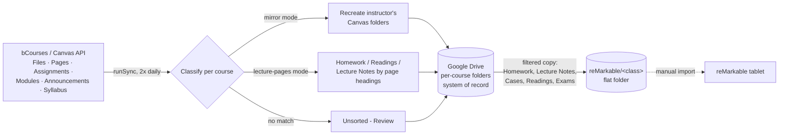

# bcourses-to-drive-sync

> **Problem:** Course files for my Haas MBA classes are scattered across bCourses (Canvas): Files tabs, lecture pages, assignments, modules and announcements. Every course organizes them differently, and downloading and filing them by hand every week was slow and easy to miss.
> **Solution:** A Google Apps Script that checks bCourses twice a day, figures out what each new file is, and files it into the right Google Drive folder. It also copies the files I study from into one flat folder per class for my reMarkable tablet.
> **Result:** Four courses sync themselves in the cloud with no laptop involved, so new material is filed in Drive within hours of being posted. Getting a class's material onto the tablet takes one import instead of a dig through nested folders.

## Why Apps Script, not Python + GitHub Actions

Berkeley's Google Workspace policy blocks 2-Step Verification enrollment on this account. That also blocks Google Cloud Console and setting up an OAuth client, which is the normal way a script running *outside* Google gets permission to call the Drive API. Apps Script avoids the problem: it runs *as* the account owner inside Google's own infrastructure and uses the same in-browser "Allow" prompt as any Docs add-on. It needs no Cloud Console, no OAuth client, no server and no laptop.

The trade-off is that Apps Script has no built-in git. This repo provides version control (commit history, diffs, this README), and the live script is pasted into the Apps Script editor to run.

## What it does

**Finds files wherever an instructor posts them.** It reads Canvas's Files tab, lecture pages, assignments, modules, announcements and the syllabus, and pulls every linked file ID out of their HTML.

**Classifies files in one of two modes per course**, because each course organizes bCourses differently:

| Mode | Used when | How files are sorted |
|---|---|---|
| `mirror` | The instructor already uses Files-tab folders (e.g. Financial Accounting, Leading People) | Recreates the instructor's own Canvas folder structure in Drive |
| `lecture-pages` | No Files-tab folders; material lives on lecture pages (e.g. Data & Decisions, Economics) | Assignment files go to `Homework`. Lecture-page files are split by the page's own section headings ("Pre-Class Reading" goes to `Readings`, "In-Class … Slides" goes to `Lecture Notes`). Anything else falls back to keywords in the filename |

**Never misfiles silently.** Anything that can't be classified lands in an `Unsorted - Review` folder for that course.

**Converts Word docs to PDF** on the way in, since PDFs are what the reMarkable can use.

**Builds a reMarkable mirror.** It adds a flat `reMarkable/<class>` copy holding only the study categories (Homework, Lecture Notes, Cases, Readings, Exams). This copy is extra: the per-course structure is unchanged and stays the system of record. The category keywords live in `REMARKABLE_CATEGORY_KEYWORDS`.

**Is safe to re-run.** A small JSON state file in Drive records every synced Canvas file ID. It's saved after *each* upload, so a crash halfway through a run never causes duplicates.

**Lets you check before you run.** `dryRun()` logs every file it *would* sync and its destination path, without changing anything.

**Stays quiet by default.** It sends an email summary only on days something new synced.

## Functions

| Function | Purpose | How it runs |
|---|---|---|
| `runSync()` | Main sync | Two daily time-driven triggers (6–7 AM, 9–10 PM) |
| `dryRun()` | Preview what would sync | Manual: run after any config or logic change |
| `backfillRemarkableFolder()` | Copy files synced before the reMarkable mirror existed (or after a keyword change) | Manual, one-off, safe to re-run |
| `pruneRemarkableFolder()` | Remove mirror copies that no longer match the category filter (moves them to Drive Trash, never touches originals) | Manual, one-off, safe to re-run |
| `scrubPracticeMaterials()` / `scrubPracticeMaterials2024_2025()` | Backfill practice exams from pages hidden from students and not linked from any module, which the normal crawl can't see | Manual, one-off |

## Repo layout

- `apps-script/Code.gs`: the full current script. The docstring at the top has the one-time setup: the `CANVAS_TOKEN` Script Property, time zone, triggers and the `COURSES` config.

## Configuration

Each course is one entry in `COURSES`: `courseId`, `driveFolderId`, `mode`, file-type filters and `remarkableFolder`. The bCourses token is stored as a Script Property (`CANVAS_TOKEN`) and never in code.

## Known limitations

- Category matching looks for a keyword anywhere in the folder path, so `exam` would also match "example". Run `dryRun()` after editing keywords.
- The reMarkable mirror is flat, so two files with the same name in different subfolders of one course would collide in the mirror (the originals are unaffected).
- Moving files from Drive onto the tablet is still a manual import, because reMarkable's Google Drive integration doesn't auto-sync.
- New terms need new `COURSES` entries.

## Part of a larger study system

This repo is the **intake layer** of a personal AI-assisted study workflow. The other pieces are Claude skills and scheduled tasks, not code in this repo:

- **Lesson prep:** builds a prep sheet the night before each class (and a slides add-on on class day), reading bCourses directly, and saves it to Drive and the reMarkable folder.
- **Exam cheat sheet:** keeps a running Concept Log per course and builds the printable exam sheet from it.
- **Homework coach:** works through problem sets with hints before answers and feeds what I struggled with into the Concept Log.
- **Meeting-notes sorter:** files Granola meeting and class notes into the same Drive course folders.

## History

Each functional change is its own commit (`v1` baseline sync → `v2` reMarkable mirror → `v3` category filter → `v4` Exams category). See `git log` for the full history.
