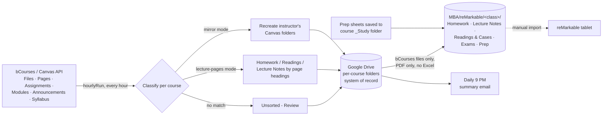

# bcourses-to-drive-sync

> **Problem:** Course files for my Haas MBA classes are scattered across bCourses (Canvas): Files tabs, lecture pages, assignments, modules and announcements. Every course organizes them differently, and downloading and filing them by hand every week was slow and easy to miss.
> **Solution:** A Google Apps Script that checks bCourses every hour, figures out what each new file is, and files it into the right Google Drive folder. It also keeps a PDF-only copy of the files I study from, sorted into Homework, Lecture Notes, Readings & Cases, Exams and Prep, for my reMarkable tablet.
> **Result:** Four courses sync themselves in the cloud with no laptop involved. Slides posted in the middle of the day reach Drive and the tablet folder within about an hour, and one summary email arrives each evening.

## Why Apps Script, not Python + GitHub Actions

Berkeley's Google Workspace policy blocks 2-Step Verification enrollment on this account. That also blocks Google Cloud Console and setting up an OAuth client, which is the normal way a script running *outside* Google gets permission to call the Drive API. Apps Script avoids the problem: it runs *as* the account owner inside Google's own infrastructure and uses the same in-browser "Allow" prompt as any Docs add-on. It needs no Cloud Console, no OAuth client, no server and no laptop.

The trade-off is that Apps Script has no built-in git. This repo provides version control (commit history, diffs, this README), and the live script is pasted into the Apps Script editor to run.

## What it does

**Finds files wherever an instructor posts them.** It reads Canvas's Files tab, lecture pages, assignments, modules, announcements and the syllabus, and pulls every linked course-file ID out of their HTML. Files students attach to posts are ignored.

**Classifies files in one of two modes per course**, because each course organizes bCourses differently:

| Mode | Used when | How files are sorted |
|---|---|---|
| `mirror` | The instructor already uses Files-tab folders (e.g. Financial Accounting, Leading People) | Recreates the instructor's own Canvas folder structure in Drive |
| `lecture-pages` | No Files-tab folders; material lives on lecture pages (e.g. Data & Decisions, Economics) | Assignment files go to `Homework`. Lecture-page files are split by the page's own section headings ("Pre-Class Reading" goes to `Readings`, "In-Class … Slides" goes to `Lecture Notes`). Anything else falls back to keywords in the filename |

**Never misfiles silently.** Anything that can't be classified lands in an `Unsorted - Review` folder for that course.

**Keeps originals in the course folders.** A Word homework file stays a Word file, so I can type my answers in it and submit it back to bCourses. Only the tablet copy is converted to PDF.

**Keeps a reMarkable folder the script owns.** Under `MBA/reMarkable/<class>/` there are five subfolders:

| Subfolder | What goes in it |
|---|---|
| `Homework` | Homework and problem sets the **professor posted** on bCourses, with practice problems in `Homework/Practice Problems` |
| `Lecture Notes` | Lecture slides and notes |
| `Readings & Cases` | Pre-reads, readings, case studies and class materials |
| `Exams` | Exams, practice finals, midterms and quizzes |
| `Prep` | My dated prep sheets (`YYYY-MM-DD – …pdf`) from each course's `_Study` folder |

The rules that keep it clean:
- Only files the script downloaded from bCourses go in. My own files (anything in a `_` folder such as `_My Work`, or anything I add by hand) never do. Prep sheets are the one deliberate exception.
- Everything is a PDF. PowerPoint and Word files are converted for the tablet copy (the originals stay as they are in the course folders), and Excel/CSV files are left out.
- The subfolder comes from ordered whole-word rules (`REMARKABLE_CATEGORIES`), so "Practice Final" lands in Exams and "example" never counts as "exam".
- A regenerated prep sheet replaces its old copy. Each copy records the original's last-updated time, so changes are caught reliably.

**Is safe to re-run.** A small JSON state file in Drive records every synced Canvas file ID. It's saved after *each* upload, so a crash halfway through a run never causes duplicates. A script lock stops two runs from overlapping.

**Lets you check before you run.** `dryRun()` logs every file it *would* sync, its Drive destination, and its reMarkable subfolder (or "not for reMarkable"), without changing anything.

**Sends one email a day.** Each run adds what it did to a queue. The run during the 9 PM Pacific hour sends one summary and clears the queue. Nothing is sent on days nothing arrived.

## Functions

| Function | Purpose | How it runs |
|---|---|---|
| `hourlyRun()` | Sync bCourses → copy prep sheets → send the daily email at 9 PM. Each step runs even if an earlier one fails | One hourly trigger |
| `runSync()` | The bCourses → Drive (+ reMarkable) sync on its own | Called by `hourlyRun`, or by hand |
| `dryRun()` | Preview what would sync and where | By hand, after any config or logic change |
| `mirrorPrepToRemarkable()` | Copy new or updated prep sheets from `_Study` to `reMarkable/<class>/Prep` | Called by `hourlyRun`, or by hand |
| `rebuildRemarkable()` | Build the reMarkable tree from files already synced, using bCourses as the source of truth, and restore Word originals that older versions stored only as PDFs. Stops before Apps Script's 6-minute limit; re-run until it says DONE | By hand, after upgrading or changing categories |
| `installTriggers()` | Delete old sync triggers and create the single hourly one | By hand, once |
| `scrubPracticeMaterials()` / `scrubPracticeMaterials2024_2025()` | Backfill practice exams from pages hidden from students and not linked from any module, which the normal crawl can't see | By hand, one-off |

## Repo layout

- `apps-script/Code.gs`: the full current script. The docstring at the top has the setup and upgrade steps.

## Configuration

Each course is one entry in `COURSES`: `courseId`, `driveFolderId`, `mode`, file-type filters and `remarkableFolder`, plus optional `extraSourceFolders` for scrub-filled folders. The bCourses token is stored as a Script Property (`CANVAS_TOKEN`) and never in code. The reMarkable root, category rules, email hour and time zone are constants at the top of the file.

## Known limitations

- Moving files from Drive onto the tablet is still a manual import, because reMarkable's Google Drive integration doesn't auto-sync.
- Hourly means "within the hour". Slides posted 15 minutes before class can still miss; the class-prep workflow reads bCourses directly as a backup.
- Folders whose names match no category (e.g. "Discussions", "reference materials") sync into Drive but aren't copied to reMarkable. Add a keyword to `REMARKABLE_CATEGORIES` to include one.
- New terms need new `COURSES` entries.

## Part of a larger study system

This repo is the **intake layer** of a personal AI-assisted study workflow. The other pieces are Claude skills and scheduled tasks, not code in this repo:

- **Lesson prep:** builds a prep sheet the night before each class (and a slides add-on on class day) from bCourses, and saves it to the course's `_Study` folder. This script then copies it to the tablet folder.
- **Exam cheat sheet:** keeps a running Concept Log per course and builds the printable exam sheet from it.
- **Homework coach:** works through problem sets with hints before answers and feeds what I struggled with into the Concept Log.
- **Meeting-notes sorter:** files Granola meeting and class notes into the same Drive course folders.

## History

Each functional change is its own commit:

| Version | Change |
|---|---|
| v1 | Baseline bCourses → Drive sync |
| v2 | reMarkable mirror (unfiltered copy) |
| v3 | Mirror filtered to study categories |
| v4 | Exams added as a category |
| v5 | reMarkable moved under MBA with five subfolders (plus Homework/Practice Problems); bCourses-only rule; course folders keep original Word files while the tablet copy is PDF-only, no Excel; Prep copied from `_Study`; hourly schedule; daily 9 PM summary email |

See `git log` for the full history.
